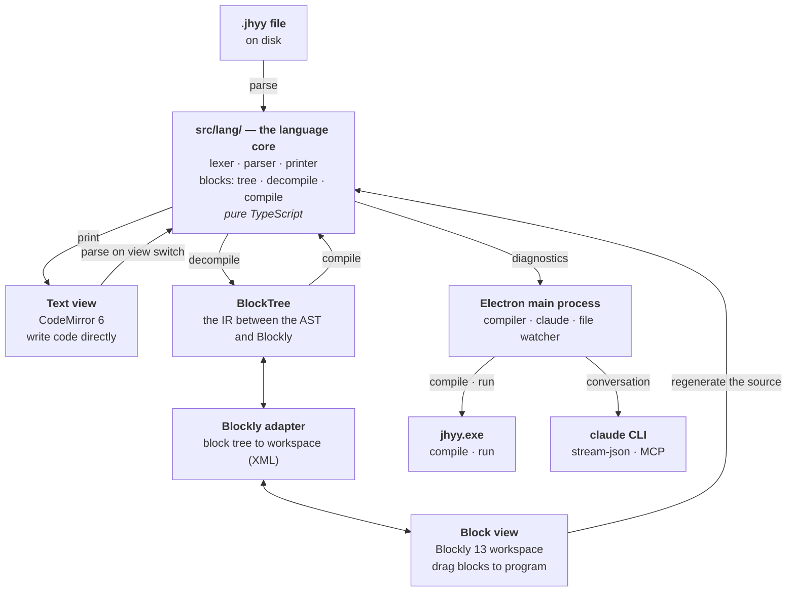

<div align="center">

<div></div>

<div></div>

### JHYY IDE — A desktop IDE for the JHYY (机会翼游) systems programming language

**Block-based. Code-based. Talks to Claude Code.**

[](CHANGELOG.md)
[](tests/conformance)
[](https://github.com/JiHuiYiYou/JiHuiYiYou-IDE/actions/workflows/ci.yml)
[](#architecture)
[](#install)
[](LICENSE)
[](README.zh-CN.md)

[What it is](#what-it-is) · [Install](#install) · [Quick start](#quick-start) · [The three views](#the-three-views) · [Architecture](#architecture) · [Testing](#testing) · [Status](#status) · [Docs](#docs)

</div>

---

## What it is

**JHYY IDE** is a desktop IDE for [JHYY (机会翼游)](https://github.com/JiHuiYiYou/JiHuiYiYou-compiler) — a self-hosted, statically typed, expression-oriented systems language.

It puts three things side by side:

1. **Block view** (Blockly) — drag blocks to program. Beginner-friendly.
2. **Text view** (CodeMirror 6) — write code like in any editor. Full language power.
3. **Claude Code** — talk to the `claude` CLI that is already on your machine.

The two coding views **share one AST**. Change a block and the text updates; change the
text and the blocks rebuild. Code that blocks can't express (generics, closures, pointers)
survives as an **opaque block** holding the original source — it never silently disappears.

## Install

**Prerequisites**:

- **Windows** x64 (the only platform built and tested so far)
- **Node.js** 20+ (developed on 24)
- **A JHYY compiler** — the IDE finds one of these automatically:
  - `../JiHuiYiYou/compiler/build/bin/jhyy.exe` (the compiler repo's dev build)
  - `C:\Program Files\JHYY\bin\jhyy.exe` (the official install)
  - `jhyy.exe` on `PATH`
  - or set `JHY_EXE`

**From source**:

```bash
git clone git@github.com:JiHuiYiYou/JiHuiYiYou-IDE.git
cd JiHuiYiYou-IDE
npm install
npm run dev
```

**Release**: grab `JHYY IDE-<version>-x64-setup.exe` from the
[Releases page](https://github.com/JiHuiYiYou/JiHuiYiYou-IDE/releases).

## Quick start

```bash
# 开发模式
npm run dev

# 直接带一个文件打开
npx electron . samples/demo.jhyy

# 构建 + 打安装包
npm run build
npm run dist
```

## The three views

### Block view

Drag blocks to write programs. The block set covers the language's everyday core:
variables, operators, `if`/`else`, `while`, `for`, functions, structs, enums, `match`,
`printf`.

Everything else — generics, turbofish, closures, pointers, borrows, slices, `defer`,
`asm!`, attributes — lands in an **opaque block** that holds the original source text.
Round-tripping is lossless: the escape hatch only changes if *you* edit it.

See [`docs/blocks-subset.md`](docs/blocks-subset.md) for the exact boundary.

### Text view

CodeMirror 6 with a hand-written JHYY language mode: syntax highlighting, bracket
matching, auto-closing, indentation, completion (keywords, types, the 8 standard-library
modules), and hover that cites the language spec section.

Diagnostics come from the **real compiler** — the IDE runs `jhyy.exe` and parses its
`file:line:col: error: …` output. A "check" pass takes ~185 ms because it skips linking.

### Claude Code

An embedded chat panel that drives the `claude` CLI already installed on your machine.
It runs in streaming mode over stdin, so the conversation keeps its context across turns.

Claude is given the **jhyy MCP server**, so it can call `jhyy_check` and get the real
compiler's diagnostics instead of guessing. Point it at a file and it will compile it,
read the errors, and fix them.

## Architecture

Three views, **one AST**. The block view and the text view can never disagree about what
a program means, because they are two projections of the same tree — and the referee is
always the real compiler.



| Layer | Where | Role |
|---|---|---|
| Language core | `src/lang/` | lexer · parser · printer · block transforms — **pure TypeScript**, no Electron / Node / Blockly, so it is unit-testable |
| Block tree | `src/lang/blocks/tree.ts` | the IR between the AST and Blockly, plus the block catalogue (the single source of truth for blocks) |
| Decompiler / compiler | `src/lang/blocks/decompile.ts` / `compile.ts` | AST → block tree / block tree → AST |
| Blockly adapter | `src/renderer/blocks/adapter.ts` | block tree ⇄ Blockly workspace (Blockly's XML is the supported load path) |
| Text editor | `src/renderer/editor/` | CodeMirror 6 + the JHYY language mode — highlight, completion, hover, lint |
| Main process | `src/main/compiler/`, `src/main/claude/` | drives `jhyy.exe` and the `claude` CLI; owns every privileged operation |
| Bridge | `src/preload/index.ts` | `contextBridge` — the renderer's only privileged surface (`contextIsolation` on, `nodeIntegration` off) |

The AST lives in `src/lang/` as **plain TypeScript** — no Electron, no Node, no Blockly
dependencies — so the parser, the printer and the block transforms are all unit-testable
in Node.

Both coding views print through the **same printer**, so they can never disagree about
what a program means. And the IDE never guesses whether a program is valid — it asks
`jhyy.exe`, and shows you the compiler's own diagnostics.

## Project layout

```
src/
  lang/                ★ language core (pure TypeScript, unit-testable)
    token.ts lexer.ts    lexer — 73 token kinds, mirroring compiler/src0/lexer.jhyy
    ast.ts               57 node kinds, mirroring compiler/src0/ast.jhyy
    parser.ts            recursive descent + Pratt, mirroring compiler/src0/parser.jhyy
    printer.ts           AST → JHYY source
    stdlib.ts            the 8 standard-library modules' API (completion / hover)
    spec.ts              language-spec index (hover cites § numbers)
    blocks/              block tree IR + decompiler + compiler
  main/                Electron main process (privileged)
    compiler/            locate / compile / run jhyy.exe, parse diagnostics
    claude/              locate / drive the claude CLI, MCP config
    watcher.ts           detect files changed outside the IDE
  preload/             contextBridge — the renderer's only way to the main process
  renderer/            UI
    editor/              CodeMirror 6 + the JHYY language mode
    blocks/              Blockly block definitions + adapter
    panes/               block / code / chat / output / problems panels
    sync/                block ⇄ text synchronisation
  shared/              types shared by main and renderer
tests/
  lang/                lexer + parser + printer unit tests
  blocks/              block round-trip tests
  compiler/            diagnostics, NTSTATUS, real-compiler integration
  conformance/         ★ the real-compiler gates (see below)
```

## Testing

The IDE's parser and printer have to say the same thing as the **real compiler**. That is
enforced against the compiler repo's own 277 example programs:

| Suite | What it does | Count |
|---|---|---|
| `tests/conformance/examples.test.ts` | IDE parses → IDE prints → **real `jhyy.exe` compiles** | 278 |
| `tests/conformance/run.test.ts` | …and then **runs** it, matching the `// EXPECT:` directives | 19 (full set: 277) |
| everything else | unit tests | 62 |

The corpus follows the compiler repo's own rule: files whose name starts with `_` are
**not** part of it (`mcp-jhyy/jhyy_regress.py:786`, `mcp-jhyy/server.py:453`,
`scripts/dev/audit_test_assertions.py:302` all exclude them). Those 9 files assert
machine-specific facts — e.g. `_jh_gcc_p1.jhyy` expects the gcc at
`C:\msys64\ucrt64\bin\gcc.exe`, a path that simply does not exist on a CI runner.

```bash
npm test                                    # all 359
npx vitest run tests/conformance            # conformance only
JHY_CONFORMANCE_FULL=1 npx vitest run tests/conformance/run.test.ts   # full 277 (≈25 min)
```

The conformance suites need the compiler repo checked out **as a sibling** of this repo —
that's how CI does it, and how you should do it locally:

```
coding/
├── JiHuiYiYou/          ← the compiler repo
└── JiHuiYiYou-IDE/      ← this repo
```

## Status

**v0.1.0** — first release. See [`CHANGELOG.md`](CHANGELOG.md).

| Area | State |
|---|---|
| Text view | ✅ done |
| Block view | ✅ done (intro subset + escape hatch) |
| Bidirectional sync | ✅ done |
| Claude Code panel | ✅ done |
| Linux / macOS | ❌ not built (Windows-only toolchain so far) |
| Code signing | ❌ not configured |

## Roadmap

- **Blocks for the escape-hatch subset** — generics, closures, pointers. Not a small job.
- **Linux build** — the language toolchain is Windows-first today.
- **LSP** — the compiler roadmap has one planned for v4.14; the IDE would be its first
  consumer.

## Docs

- **[Wiki](https://github.com/JiHuiYiYou/JiHuiYiYou-IDE/wiki)** — the long-form guide: getting
  started, architecture, the block subset, troubleshooting, how to add a block
- [`CLAUDE.md`](CLAUDE.md) — architecture, the three rules, language gotchas, how to add a block
- [`docs/blocks-subset.md`](docs/blocks-subset.md) — what has blocks, what doesn't, and why
- [`CONTRIBUTING.md`](CONTRIBUTING.md) — how to contribute, and what the CI gates check
- [JHYY language spec](https://github.com/JiHuiYiYou/JiHuiYiYou-compiler/blob/main/docs/abis/jhyy-lang-spec-v4.0.0.md)
- [JHYY compiler](https://github.com/JiHuiYiYou/JiHuiYiYou-compiler)

## License

[MIT](LICENSE)
