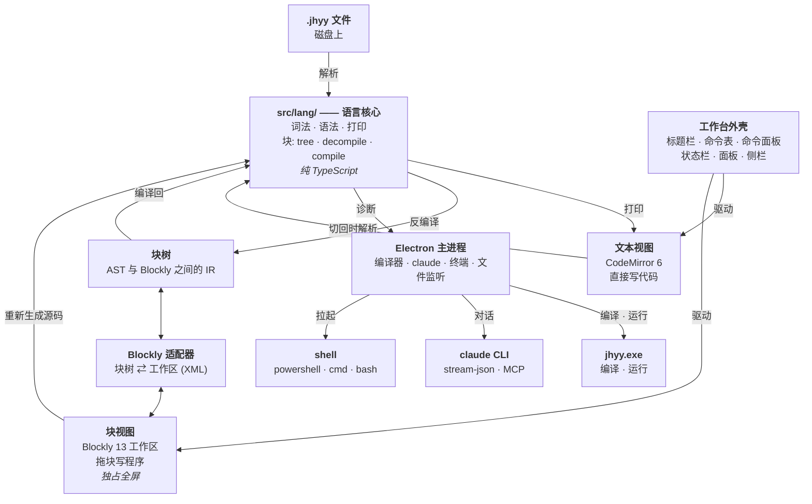

<div align="center">

<div></div>

<div></div>

### JHYY IDE —— 给机会翼游（JHYY）做的桌面 IDE

**拖块写。写代码。跟 Claude Code 聊。**

[](CHANGELOG.md)
[](tests/conformance)
[](https://github.com/JiHuiYiYou/JiHuiYiYou-IDE/actions/workflows/ci.yml)
[](#架构)
[](#安装)
[](LICENSE)
[](README.md)

[这是什么](#这是什么) · [安装](#安装) · [快速开始](#快速开始) · [工作台](#工作台) · [架构](#架构) · [测试](#测试) · [状态](#状态) · [文档](#文档)

</div>

---

## 这是什么

**JHYY IDE** 是给 [JHYY（机会翼游）](https://github.com/JiHuiYiYou/JiHuiYiYou-compiler)
——一门自举的、静态类型的、表达式导向的系统编程语言 —— 做的桌面 IDE。

一个**VS Code 式的工作台**：

- **文本视图**（CodeMirror 6）—— 正常写代码，完整语言能力
- **块视图**（Blockly）—— 拖块写程序，入门友好。**独占整块编辑区**，跟文本视图
  **不同时显示** —— `Ctrl+Shift+B` 切过去
- **Claude Code** —— 右侧栏里的对话面板，直接对话你本机已经装好的 `claude` CLI
- **底部面板** —— 问题 / 输出 / **真终端**。**默认隐藏**，点**检查**或**运行**才弹出来

两个写代码的视图**共用同一个 AST**。改块 → 文本跟着变；改文本 → 块重建。
块表达不了的语法（泛型、闭包、指针）会变成**不透明块**，里面装着原始源码 —— **不会悄悄消失**。

外壳照着 VS Code 抄：自绘标题栏（菜单栏 / 命令中心 / 布局开关）、`Ctrl+Shift+P` 的命令面板、
状态栏，还有一整套常用快捷键。

## 安装

**前置条件**：

- **Windows** x64（目前只构建和验证了这一个平台）
- **Node.js** 20+（开发用的是 24）
- **一个 JHYY 编译器** —— IDE 会自动找下面几个：
  - `../JiHuiYiYou/compiler/build/bin/jhyy.exe`（编译器仓库的开发构建）
  - `C:\Program Files\JHYY\bin\jhyy.exe`（官方安装版）
  - `PATH` 上的 `jhyy.exe`
  - 或设 `JHY_EXE` 环境变量

**从源码装**：

```bash
git clone git@github.com:JiHuiYiYou/JiHuiYiYou-IDE.git
cd JiHuiYiYou-IDE
npm install
npm run dev
```

**发行版**：去 [Releases 页](https://github.com/JiHuiYiYou/JiHuiYiYou-IDE/releases)
拿 `JHYY-IDE-<版本>-x64-setup.exe`。

## 快速开始

```bash
# 开发模式
npm run dev

# 直接带一个文件打开
npx electron . samples/demo.jhyy

# 构建 + 打安装包
npm run build
npm run dist
```

## 工作台

```
┌────────────────────────────────────────────────────────────────────────┐
│ ◈ 文件 编辑 选择 查看 转到  ← →  ┌🔍 搜索文件 / 输入命令 ──────┐ 💬 🧩 ▣ │ ← 自绘标题栏
├──────────────────────────────────────────────────────┬─────────────────┤
│ [📄 demo.jhyy ×]                        [✓][▶][■][🧩] │ 聊天            │
│ C: › Users › liuzhen › … › demo.jhyy                  │  ┌───────────┐  │
│ ──────────────────────────────────────────────────── │  │ 会话列表  │  │
│                                                      │  └───────────┘  │
│              文本编辑器（CodeMirror 6）                 │  ┌───────────┐  │
│         ⇅ Ctrl+Shift+B 切到拖块，画布满屏                │  │ 输入框    │  │
│                                                      │  └───────────┘  │
├──────────────────────────────────────────────────────┴─────────────────┤
│ 问题 │ 输出 │ 终端                     [🗑][⛶][✕]  ← 默认隐藏            │
├────────────────────────────────────────────────────────────────────────┤
│ ◈ JHYY │ Ln 11, Col 10 │ 空格:4 │ UTF-8 │ JHY          编译器: 就绪    │
└────────────────────────────────────────────────────────────────────────┘
```

### 块视图

拖块写程序。块子集覆盖语言日常用的部分：变量、运算、`if`/`else`、`while`、`for`、
函数、结构体、枚举、`match`、`printf`。

**工具箱第一屏是「入门」** —— 函数、打印、调用、数字/字符串、变量、返回、
**C 函数声明**。每个 JHYY 程序的第一行 `extern fn printf(...)` 现在有现成的块
（下拉里直接选 `printf` / `puts` / `malloc` …，参数表自动填好），
**不用再靠「原始代码」逃生舱手打**。

其余的 —— 泛型、turbofish、闭包、指针、借用、切片、`defer`、`asm!`、属性 ——
会落进一个**不透明块**，里面是原始源码文本。往返无损：只有**你**动了它，那部分才会变。

边界见 [`docs/blocks-subset.md`](docs/blocks-subset.md)。

**块视图和文本视图从不同时占屏。** 块画布满整个编辑区，代码编辑器整个消失 ——
用标题栏的 🧩 按钮、`Ctrl+Shift+B` 或命令面板切。切换时两边都**保留状态**
（画布的缩放/平移、编辑器的撤销历史和光标位置）。

### 文本视图

CodeMirror 6 + 手写的 JHYY 语言模式：语法高亮、括号匹配、自动闭合、缩进、
补全（关键字、类型、8 个标准库模块），以及能给出**规范章节号**的悬停提示。

诊断来自**真实编译器** —— IDE 跑 `jhyy.exe` 并解析它的
`file:line:col: error: …` 输出。「检查」一趟 ~185ms（跳过链接）。
在问题面板里点一条诊断，直接跳到那一行那一列。

文件开在**标签页**里 —— 开第二个文件不会把第一个顶掉，每个标签各自记着自己的
内容、脏状态和块。小黑点是**按内容算**的（跟 VS Code 一样），
所以撤销回上次保存的版本，小圆点自动消失。

### Claude Code

右侧栏里的内嵌对话面板，驱动你本机已经装好的 `claude` CLI。走 stdin 的流式模式，
所以多轮对话上下文是连着的。

Claude 拿到了 **jhyy MCP server** —— 它能调 `jhyy_check` 拿到**真实编译器**的诊断，
而不是靠猜。指个文件给它，它会自己编译、自己读报错、自己改对。

### 面板、终端和外壳

底部面板装着**问题**、**输出**（程序的标准输出/错误 + 编译器自己的日志）和一个**终端**。
**每次启动都是收着的**，点**检查**（切到问题）或**运行**（切到输出）时弹出来 —— `Ctrl+J` 开关它。
它只在**编辑器下面**，聊天侧栏始终是整列的，不会被面板压小。

终端是真 shell —— 默认 **MSYS2 bash**（PowerShell 和 `cmd` 也随时能切）。
⚠️ 它跑在**管道上，不是 PTY**（这台机器没有 MSVC，`node-pty` 给 Electron 编不出来）——
所以 `vim`、`top` 这类全屏 TUI 程序跑不了。别的都好使：bash 的 readline 在管道下
有**真正的行编辑**（退格、方向键、历史、增量回显），
中文 Windows 上的输出也是 UTF-8 的。

跟 VS Code 的集成终端一样，它会**把 IDE 执行的命令也显示出来** ——
按**运行**，终端里能看到 `> jhyy compile "…"` 和程序的输出。

没打开文件时，编辑器显示的是**欢迎页**（打开 / 新建），不是一段示例代码。

### 快捷键

| 快捷键 | 作用 | | 快捷键 | 作用 |
|---|---|---|---|---|
| `Ctrl+Shift+P` | 命令面板 | | `Ctrl+J` | 显示/隐藏 底部面板 |
| `Ctrl+Shift+B` | 切换 块视图 / 文本视图 | | `Ctrl+Shift+M` | 问题 |
| `Ctrl+S` / `Ctrl+O` | 保存 / 打开 | | `Ctrl+Shift+U` | 输出 |
| `F5` / `Shift+F5` | 运行 / 停止 | | ``Ctrl+` `` | 终端 |
| `Ctrl+Shift+D` | 检查 | | `Ctrl+Alt+I` | 聊天 |
| `Ctrl+B` | 显示/隐藏 聊天侧栏 | | `Ctrl+Alt+B` | 显示/隐藏 辅助侧边栏 |

完整表在**查看**菜单和命令面板里 —— 菜单和快捷键**从同一张命令表生成**，不会各说各话。

## 架构

两个写代码的视图，**一个 AST**。块视图和文本视图不可能对同一份程序有不同理解 —— 它们是
同一棵树的两个投影。而裁判永远是真实编译器。



| 层 | 位置 | 干什么 |
|---|---|---|
| 语言核心 | `src/lang/` | 词法 · 语法 · 打印 · 块转换 —— **纯 TypeScript**，不依赖 Electron / Node / Blockly，所以能单测 |
| 块树 | `src/lang/blocks/tree.ts` | AST 与 Blockly 之间的 IR + 块目录（块的唯一真相） |
| 反编译器 / 编译器 | `src/lang/blocks/decompile.ts` / `compile.ts` | AST → 块树 / 块树 → AST |
| Blockly 适配器 | `src/renderer/blocks/adapter.ts` + `xml.ts` | 块树 ⇄ Blockly 工作区；XML 那一半是纯 DOM，有单测 |
| 工作台外壳 | `src/renderer/workbench/`、`src/renderer/commands/` | 标题栏 · 菜单栏 · 命令面板 · 面板 · 状态栏 —— **一张命令表**同时喂给菜单、命令面板和快捷键 |
| 文本编辑器 | `src/renderer/editor/` | CodeMirror 6 + JHYY 语言模式 —— 高亮、补全、悬停、波浪线 |
| 主进程 | `src/main/compiler/`、`src/main/claude/`、`src/main/terminal.ts` | 驱动 `jhyy.exe`、`claude` CLI 和终端 shell；所有特权操作都在这儿 |
| 桥接 | `src/preload/index.ts` | `contextBridge` —— 渲染进程唯一的特权入口（`contextIsolation` 开，`nodeIntegration` 关） |

AST 在 `src/lang/` 里，是**纯 TypeScript** —— 不依赖 Electron / Node / Blockly ——
所以解析器、打印器、块转换器都能在 Node 里跑单测。

两个写代码的视图**走同一个打印器** —— 所以它们不可能对同一份程序有不同理解。
而且 IDE 从不猜程序对不对 —— 它去问 `jhyy.exe`，把编译器自己的诊断显示给你。

## 目录

```
src/
  lang/                ★ 语言核心（纯 TS，可单测）
    token.ts lexer.ts    词法 —— 73 个 token 种类，对齐 compiler/src0/lexer.jhyy
    ast.ts               57 个节点种类，对齐 compiler/src0/ast.jhyy
    parser.ts            递归下降 + Pratt，对齐 compiler/src0/parser.jhyy
    printer.ts           AST → JHYY 源码
    stdlib.ts            8 个标准库模块的 API（补全 / 悬停用）
    spec.ts              语言规范索引（悬停给章节号）
    blocks/              块树 IR + 反编译器 + 编译器
  main/                Electron 主进程（有特权）
    compiler/            定位 / 编译 / 运行 jhyy.exe，解析诊断
    claude/              定位 / 驱动 claude CLI，MCP 配置
    terminal.ts          终端会话（管道上的 shell）
    watcher.ts           发现 IDE 外面被改过的文件
  preload/             contextBridge —— 渲染进程碰到主进程的唯一途径
  renderer/            UI
    workbench/           标题栏 · 菜单栏 · 命令面板 · 面板 · 状态栏
    commands/            ★ 命令表（菜单 + 命令面板 + 快捷键）
    editor/              CodeMirror 6 + JHYY 语言模式
    blocks/              Blockly 块定义 + 适配器（+ 纯 DOM 的 XML 那一半）
    panes/               代码 / 块 / 对话 / 输出 / 问题 / 终端 面板
    state/               布局状态（存 localStorage）
    sync/                块 ⇄ 文本 同步
  shared/              主 / 渲染 共用的类型
tests/
  lang/                词法 + 语法 + 打印 单测
  blocks/              块往返测试
  renderer/            工作台单测（快捷键规范化、块 XML 往返）
  compiler/            诊断、NTSTATUS、真实编译器集成
  conformance/         ★ 真实编译器的一致性门（见下）
```

## 测试

IDE 的解析器和打印器必须跟**真实编译器**说同样的话。这靠编译器仓库自己的
277 个示例程序来保证：

| 套件 | 干什么 | 数量 |
|---|---|---|
| `tests/conformance/examples.test.ts` | IDE 解析 → IDE 打印 → **真实 `jhyy.exe` 编译** | 278 |
| `tests/conformance/run.test.ts` | ……然后**真跑一遍**，比对 `// EXPECT:` 指令 | 19（全量：277） |
| 其余 | 单测 | 88 |

语料口径跟语言仓库自己的规则一致：**以 `_` 开头的文件不进语料**
（`mcp-jhyy/jhyy_regress.py:786`、`mcp-jhyy/server.py:453`、
`scripts/dev/audit_test_assertions.py:302` 三处都排除）。那 9 个文件断言的是
**跟机器绑定**的事实 —— 比如 `_jh_gcc_p1.jhyy` 期望 gcc 在
`C:\msys64\ucrt64\bin\gcc.exe`，CI 机器上那个路径压根不存在。

```bash
npm test                                    # 全部 385
npx vitest run tests/conformance            # 只跑一致性
JHY_CONFORMANCE_FULL=1 npx vitest run tests/conformance/run.test.ts   # 全量 277（约 25 分钟）
```

一致性套件需要把编译器仓库 checkout 在**本仓库的兄弟目录** —— CI 就是这么做的，
本地也应该这么放：

```
coding/
├── JiHuiYiYou/          ← 编译器仓库
└── JiHuiYiYou-IDE/      ← 本仓库
```

## 状态

**v0.1.0** —— 首个发行版。见 [`CHANGELOG.md`](CHANGELOG.md)。

| 部分 | 状态 |
|---|---|
| 文本视图 | ✅ 完成 |
| 块视图 | ✅ 完成（入门子集 + 逃生舱） |
| 双向同步 | ✅ 完成 |
| Claude Code 面板 | ✅ 完成 |
| VS Code 式工作台 | ✅ 完成（标题栏 · 命令面板 · 面板 · 状态栏 · 快捷键） |
| 终端 | ✅ 完成（管道，**没有 PTY** —— 跑不了全屏 TUI 程序） |
| Linux / macOS | ❌ 未构建（目前只有 Windows 工具链） |
| 代码签名 | ❌ 未配置 |

## 路线图

- **给逃生舱那部分做块** —— 泛型、闭包、指针。不是小活。
- **Linux 构建** —— 语言工具链目前是 Windows 优先。
- **LSP** —— 编译器路线图 v4.14 有一个；IDE 会是它的第一个使用者。

## 文档

- **[Wiki](https://github.com/JiHuiYiYou/JiHuiYiYou-IDE/wiki)** —— 长文版指南：快速上手、
  架构、块子集、疑难排查、怎么加一个新块
- [`CLAUDE.md`](CLAUDE.md) —— 架构、三条铁律、语言坑、加新块的流程
- [`docs/blocks-subset.md`](docs/blocks-subset.md) —— 哪些语法有块，哪些没有，为什么
- [`CONTRIBUTING.md`](CONTRIBUTING.md) —— 怎么贡献，CI 的门验的是什么
- [JHYY 语言规范](https://github.com/JiHuiYiYou/JiHuiYiYou-compiler/blob/main/docs/abis/jhyy-lang-spec-v4.0.0.md)
- [JHYY 编译器](https://github.com/JiHuiYiYou/JiHuiYiYou-compiler)

## 协议

[MIT](LICENSE)
