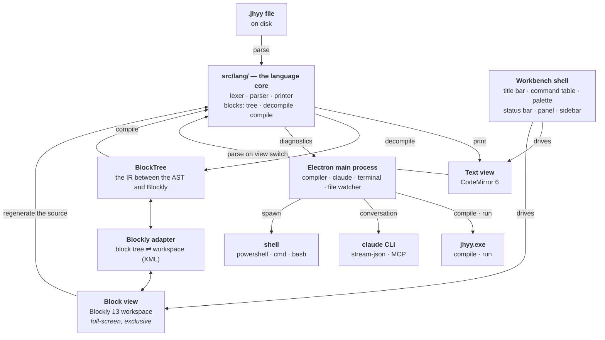

# Architecture

## The shape of it



## The layers

| Layer | Where | Role |
|---|---|---|
| Language core | `src/lang/` | lexer · parser · printer · block transforms |
| Block tree | `src/lang/blocks/tree.ts` | the IR between the AST and Blockly, plus the block catalogue |
| Decompiler / compiler | `src/lang/blocks/decompile.ts` / `compile.ts` | AST → block tree / block tree → AST |
| Blockly adapter | `src/renderer/blocks/adapter.ts` + `xml.ts` | block tree ⇄ Blockly workspace; the XML half is pure DOM and unit-tested |
| Workbench shell | `src/renderer/workbench/`, `src/renderer/commands/` | title bar · menu bar · command palette · panel · status bar — **one command table** feeds the menus, the palette and the keybindings |
| Text editor | `src/renderer/editor/` | CodeMirror 6 + the JHYY language mode |
| Main process | `src/main/compiler/`, `src/main/claude/`, `src/main/terminal.ts` | drives `jhyy.exe`, the `claude` CLI and the terminal shell |
| Bridge | `src/preload/index.ts` | `contextBridge` — the renderer's only privileged surface |

## Three rules

### 1. The AST is the single truth

The block view and the text view are two projections of **one** tree:

```
source ──parse──▶ AST ──decompile──▶ block tree ──▶ Blockly workspace
                 ▲                                      │
                 └──────────── block tree ◀─────────────┘

block tree ──compile──▶ AST ──print──▶ source
```

`src/lang/` is **plain TypeScript** — no Electron, no Node, no Blockly — so the parser,
the printer and the block transforms are all unit-testable in plain Node.

Never write a second code generator for the block view. Two generators mean two
interpretations of the same program, and they will drift.

### 2. Printed code must be accepted by the real compiler

`jhyy.exe` is the referee. Every change to `src/lang/` has to survive the conformance
gate: the language repository's own example programs are parsed by the IDE, printed back
to source, and handed to the real compiler — then compiled, run, and compared against
their own `// EXPECT:` directives.

```
IDE parse ──▶ IDE print ──▶ real jhyy.exe ──▶ run ──▶ compare against // EXPECT:
```

### 3. The language rules come from the compiler, not from the docs

The compiler lives in `../JiHuiYiYou/compiler/src0/` and is **written in JHYY itself**.
When the documentation and the compiler disagree, the compiler wins.

## Where to change what

| You want to… | Touch |
|---|---|
| support a new syntax in the text view | `src/lang/lexer.ts`, `src/lang/parser.ts`, `src/lang/printer.ts` |
| give a construct a block | `src/lang/blocks/tree.ts` → `src/renderer/blocks/definitions.ts` → `decompile.ts` → `compile.ts` → `buildToolbox()` |
| change how the compiler is invoked | `src/main/compiler/` |
| change how Claude is invoked | `src/main/claude/` |
| change how the terminal shell is spawned | `src/main/terminal.ts` |
| add a command, a menu entry or a shortcut | `src/renderer/commands/registry.ts` — **one table, three consumers** |
| change what the UI looks like | `src/renderer/workbench/`, `src/renderer/styles.css` |

The IDE never re-implements the language. It parses the source, prints it back, and lets
the real compiler decide.

## The one command table

The menu bar, the command palette and the keyboard shortcuts are **three views of one
array** (`src/renderer/commands/registry.ts`). A command declares its own shortcut, and
the menu renders that shortcut next to the label — so the two can never drift apart.

> ⚠️ Two things to know before you add one:
> - The shortcut string must match `chordOf()`'s normalisation exactly
>   (`Ctrl+Shift+P`, single letters **upper-case**, `` ` `` spelled `Backquote`).
>   `tests/renderer/chord.test.ts` pins that format down.
> - `scope: 'editor'` commands only fire when the CodeMirror view has focus, so the
>   clipboard and undo keys keep working in the chat box.

## Synchronisation semantics

| Direction | When | What happens |
|---|---|---|
| blocks → text | immediately (debounced) | the source is regenerated and the text view is replaced; the cursor is mapped back by longest common prefix/suffix |
| text → blocks | when you switch to the block view | the file is re-parsed and the blocks are rebuilt |

Rebuilding blocks on every keystroke would make the canvas jitter and be unusable, so it
only happens on the view switch. Anything that cannot be expressed as blocks becomes an
opaque block — and the IDE tells you when that happened.

The block canvas and the text editor are **both mounted at all times**; the inactive one
is hidden with `visibility: hidden` + `inert`, not `display: none` — `display: none` would
give Blockly a zero-sized container and break its coordinate system. See
`src/renderer/styles.css` and `src/renderer/panes/BlockPane.tsx`.

## Process model

The Electron **main process** owns every privileged operation: running the compiler,
spawning the compiler's output, driving the `claude` CLI, spawning the terminal shell,
watching files. The **renderer** only draws and runs the pure-TypeScript language core.
They talk through a narrow `contextBridge` surface in `src/preload/index.ts` —
`contextIsolation` on, `nodeIntegration` off.

> ⚠️ The window has **no native frame** (`titleBarStyle: 'hidden'` +
> `titleBarOverlay`), so the title bar is drawn by the renderer — including the drag
> region (`-webkit-app-region: drag`) and the ~138px the OS window buttons sit on top of.
> And `Menu.setApplicationMenu(null)` in the main process is **mandatory**: the default
> Electron menu's accelerators (`F5`, `Ctrl+R`, `Ctrl+W`, `Ctrl+C/V/Z/A`) are consumed
> before the renderer ever sees the key.
