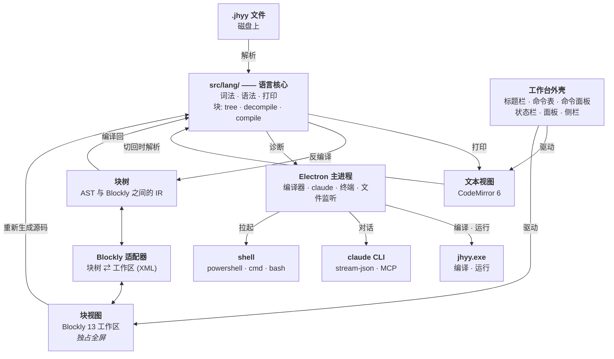

# 架构

## 全貌



## 分层

| 层 | 位置 | 干什么 |
|---|---|---|
| 语言核心 | `src/lang/` | 词法 · 语法 · 打印 · 块转换 |
| 块树 | `src/lang/blocks/tree.ts` | AST 与 Blockly 之间的 IR + 块目录 |
| 反编译器 / 编译器 | `src/lang/blocks/decompile.ts` / `compile.ts` | AST → 块树 / 块树 → AST |
| Blockly 适配器 | `src/renderer/blocks/adapter.ts` + `xml.ts` | 块树 ⇄ Blockly 工作区；XML 那一半是纯 DOM，有单测 |
| 工作台外壳 | `src/renderer/workbench/`、`src/renderer/commands/` | 标题栏 · 菜单栏 · 命令面板 · 面板 · 状态栏 —— **一张命令表**同时喂给菜单、命令面板和快捷键 |
| 文本编辑器 | `src/renderer/editor/` | CodeMirror 6 + JHYY 语言模式 |
| 主进程 | `src/main/compiler/`、`src/main/claude/`、`src/main/terminal.ts` | 驱动 `jhyy.exe`、`claude` CLI 和终端 shell |
| 桥接 | `src/preload/index.ts` | `contextBridge` —— 渲染进程唯一的特权入口 |

## 三条铁律

### 1. AST 是唯一的真相

块视图和文本视图是**同一棵**树的两个投影：

```
源码 ──解析──▶ AST ──反编译──▶ 块树 ──▶ Blockly 工作区
                ▲                                 │
                └──────────── 块树 ◀─────────────┘

块树 ──编译──▶ AST ──打印──▶ 源码
```

`src/lang/` 是**纯 TypeScript** —— 不依赖 Electron / Node / Blockly —— 所以解析器、
打印器、块转换器都能在纯 Node 里跑单测。

**永远不要**给块视图写第二套代码生成器。两套生成器 = 对同一份程序两种理解，
迟早漂移。

### 2. 打印出来的代码必须能被真实编译器接受

`jhyy.exe` 是裁判。`src/lang/` 的任何改动都得过一致性门：语言仓库自己的示例程序
被 IDE 解析、打印回源码、交给真实编译器 —— 然后编译、运行，再跟它们自己的
`// EXPECT:` 指令比对。

```
IDE 解析 ──▶ IDE 打印 ──▶ 真实 jhyy.exe ──▶ 运行 ──▶ 比对 // EXPECT:
```

### 3. 语言规则以编译器为准，不是以文档为准

编译器在 `../JiHuiYiYou/compiler/src0/`，而且**是用 JHYY 自己写的**。
文档和编译器打架的时候，听编译器的。

## 改哪儿

| 你想…… | 动 |
|---|---|
| 让文本视图支持新语法 | `src/lang/lexer.ts`、`src/lang/parser.ts`、`src/lang/printer.ts` |
| 给某个语法加块 | `src/lang/blocks/tree.ts` → `src/renderer/blocks/definitions.ts` → `decompile.ts` → `compile.ts` → `buildToolbox()` |
| 改编译器怎么调 | `src/main/compiler/` |
| 改 Claude 怎么调 | `src/main/claude/` |
| 改终端怎么起 shell | `src/main/terminal.ts` |
| 加命令、菜单项或快捷键 | `src/renderer/commands/registry.ts` —— **一张表，三个消费方** |
| 改界面长什么样 | `src/renderer/workbench/`、`src/renderer/styles.css` |

IDE 从不重新实现语言。它解析源码、把源码打印回去，然后让真实编译器裁决。

## 一张命令表

菜单栏、命令面板、快捷键是**同一个数组**的三种看法
（`src/renderer/commands/registry.ts`）。命令自己声明快捷键，菜单就把这个快捷键
显示在标签旁边 —— 两边不可能各说各话。

> ⚠️ 加之前要知道两件事：
> - 快捷键字符串必须跟 `chordOf()` 的规范化**完全一致**
>   （`Ctrl+Shift+P`，单字母**大写**，`` ` `` 拼成 `Backquote`）。
>   `tests/renderer/chord.test.ts` 把这个格式钉住了。
> - `scope: 'editor'` 的命令只在 CodeMirror 有焦点时才触发 ——
>   聊天输入框里的复制和撤销还是原生的。

## 同步语义

| 方向 | 什么时候 | 发生什么 |
|---|---|---|
| 块 → 文本 | 立即（debounce） | 重新生成整份源码并替换文本视图；光标按最长公共前缀/后缀映射回原位 |
| 文本 → 块 | 你切到块视图时 | 重新解析整个文件并重建块 |

每敲一个键就重建块会让画布抖到没法用，所以只在切视图时做。表达不成块的部分会变成
不透明块 —— IDE 会告诉你这件事发生了。

块画布和文本编辑器**一直都在**，不 active 的那个用 `visibility: hidden` + `inert`
藏起来，**不是** `display: none` —— `display: none` 会给 Blockly 一个 0 尺寸的容器，
坐标系就崩了。见 `src/renderer/styles.css` 和 `src/renderer/panes/BlockPane.tsx`。

## 进程模型

Electron **主进程**持有全部特权操作：跑编译器、spawn 编译产物、驱动 `claude` CLI、
拉起终端 shell、监听文件。**渲染进程**只负责画界面和跑纯 TS 的语言核心。两边通过
`src/preload/index.ts` 里一层窄的 `contextBridge` 通信 —— `contextIsolation` 开，
`nodeIntegration` 关。

> ⚠️ 窗口**没有原生边框**（`titleBarStyle: 'hidden'` + `titleBarOverlay`），
> 标题栏是渲染进程画的 —— 包括拖拽区（`-webkit-app-region: drag`）
> 和系统窗口按钮盖着的那 ~138px。
> 主进程里 `Menu.setApplicationMenu(null)` 是**必须的**：Electron 默认菜单的
> accelerator（`F5`、`Ctrl+R`、`Ctrl+W`、`Ctrl+C/V/Z/A`）会在渲染进程看到按键之前
> 就被吃掉。
